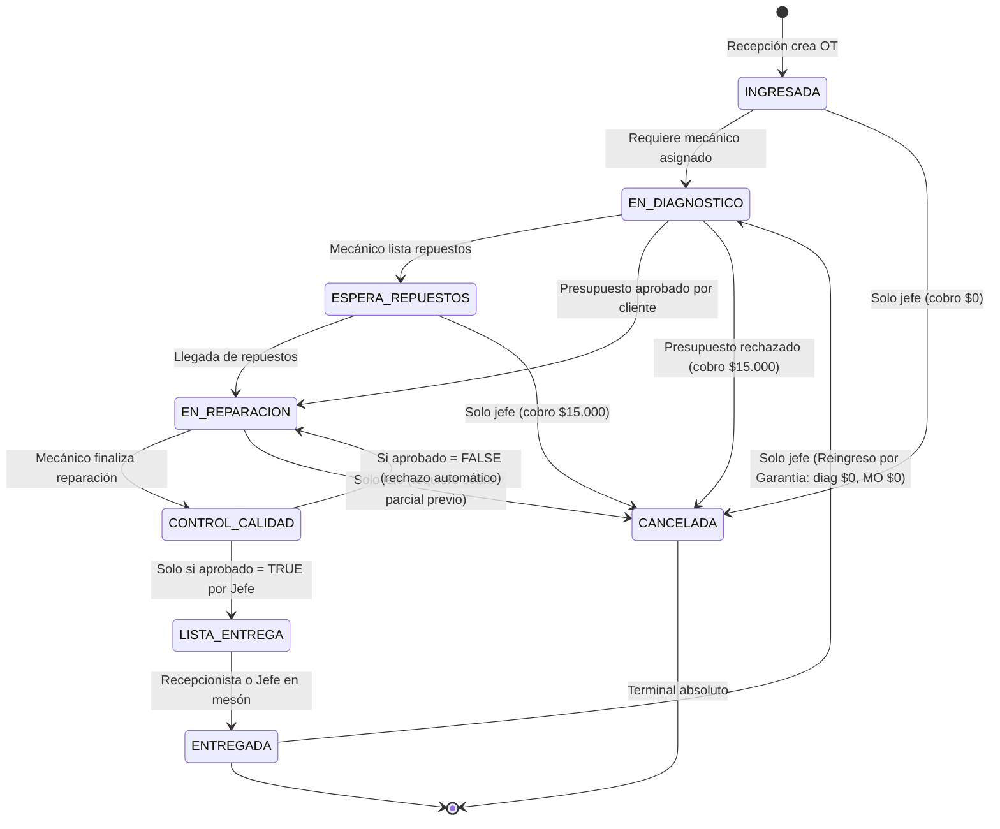

# TecniMotor — Documentación y Reglas de Negocio: Sprint 3

> **Propósito:** Registro técnico oficial del Sprint 3, integrando las consideraciones de negocio definitivas (`docs/consideraciones_negocio.md`), la arquitectura de roles, el modelo relacional adaptado a SQLite y el avance de implementación paso a paso para la evaluación y cierre del proyecto.

---

## 1. Alcance y Objetivos del Sprint 3

El Sprint 3 consolida la **operación multi-rol del taller**, la **atención y consulta al cliente sin fricción** y el **detalle técnico avanzado de las órdenes de trabajo**, preparando el terreno previo a la persistencia definitiva en MySQL 8.0 (Sprint 4).

### Metas Funcionales (Historias de Usuario)
* **HU-01 (Recepción y Clientes):** Vista dedicada para Recepción para búsqueda rápida de OTs, registro de vehículos y directorio de clientes.
* **HU-05 (Registro de Horas Hombre):** Cómputo de tiempos y tarifas por hora asociadas a los técnicos asignados a una OT. Restricción estricta: prohibido registrar horas durante `EN_DIAGNOSTICO`.
* **HU-06 (Máquina de Estados y Auditoría):** Restricción de transiciones arbitrarias de estado y trazabilidad obligatoria de cambios.
* **HU-07 (Control de Calidad):** Certificación técnica obligatoria por el Jefe de Taller antes de que una orden pase a lista para entrega. Con rechazo automático de vuelta a `EN_REPARACION`.
* **HU-08 (Consulta Pública de Clientes):** Portal público responsivo de seguimiento en tiempo real mediante RUT y Patente, sin requerir usuario ni contraseña.
* **HU-10 (Detalle de Repuestos para Costeo):** Registro estructurado de piezas y repuestos asociados a una OT con desglose de 4 líneas (Diagnóstico, Repuestos, Mano de obra, IVA 19%).

---

## 2. Matriz de Roles y Principio de Mínimo Privilegio (RBAC)

El sistema define 4 roles principales con responsabilidades estrictamente segregadas (el rol de *Encargado de Repuestos* fue formalmente descartado al diferirse el control de stock de bodega):

| Rol | Vistas Asignadas | Permisos Operativos | Restricciones Clave |
| :--- | :--- | :--- | :--- |
| **Cliente (Público)** | Portal de Consulta (`/seguimiento`) | Consultar el estado de avance, fechas estimadas y resumen técnico de su vehículo ingresando **RUT + Patente**. | Solo lectura. No accede a costos internos, tarifas ni datos de otros clientes. |
| **Recepción** | Inicio de Recepción y Directorio Clientes/Vehículos | Crear clientes y vehículos. Abrir nuevas OTs (`ING`). Consultar órdenes en tabla. Enviar presupuesto por correo y registrar aprobación por llamada. Realizar la entrega final del vehículo (`ENT`). | No cambia estados intermedios. No cancela OTs. No ve cobros ni tarifas internas. No edita diagnósticos. |
| **Mecánico** | "Mis Órdenes" y Detalle Técnico de OT | Ver OTs asignadas a su nombre. Editar diagnóstico y observaciones. Registrar repuestos utilizados y horas hombre trabajadas. | No registra horas durante `EN_DIAGNOSTICO`. No cambia estados administrativos, no aprueba calidad, no cancela OTs. Solo ve el cobro final de sus propias OTs sin poder editarlo. |
| **Jefe de Taller** | Dashboard Kanban Global, Detalle Completo de OT y Cobros | Abre OTs, cambia cualquier estado y es el **único facultado para cancelar OTs**. Aprueba o rechaza Control de Calidad. Genera cobros parciales/finales. Autoriza reingreso por garantía y asigna segundo mecánico de apoyo. | Supervisor operativo integral del taller. |
| **Administrador** | Panel de Configuración Django | Acceso total técnico a la plataforma y gestión de usuarios. | Mantenimiento del sistema. |

---

## 3. Reglas de Negocio Oficiales (Definitivas)

### 3.1 Tarifa Base de Diagnóstico ($15.000 siempre)
* Toda orden de trabajo devenga un costo fijo de **$15.000 CLP netos** por concepto de revisión técnica inicial.
* Aparece siempre como línea separada visible: `"Revisión y diagnóstico inicial — $15.000"`.
* Si el cliente rechaza el presupuesto, el cobro final liquidado tiene exclusivamente esta línea de $15.000 más IVA.
* **Excepción de Reingreso por Garantía:** Si el vehículo vuelve por un trabajo mal hecho (`reingresado_por_garantia = True`), el diagnóstico se fija automáticamente en **$0 CLP**. La mano de obra tampoco se cobra; únicamente repuestos nuevos ajenos al problema original.

### 3.2 Presupuesto y Aprobación
* Al finalizar el diagnóstico, el sistema calcula un presupuesto preliminar (Diagnóstico + Repuestos proyectados + Horas estimadas).
* Recepción o el Jefe contactan al cliente por correo o teléfono.
* El sistema no puede avanzar de `EN_DIAGNOSTICO` a `EN_REPARACION` si el presupuesto fue rechazado por el cliente. Si es rechazado, se cancela y se cobra solo el diagnóstico.

### 3.3 Estructura Oficial del Cobro Final (4 Líneas)
Toda orden cerrada exitosamente calcula los valores en Django y se persisten sin recálculos posteriores:

```text
1. Diagnóstico inicial          $15.000 (o $0 en garantía)
2. Repuestos                    $XX.XXX
3. Mano de obra                 $XX.XXX
───────────────────────────────────────
Subtotal neto                   $XX.XXX
IVA 19%                         $XX.XXX
───────────────────────────────────────
Total a pagar                   $XX.XXX
```

### 3.4 Cancelación de OTs (Exclusiva del Jefe de Taller)
* Solo el Jefe de Taller puede cancelar una orden.
* Si está en `INGRESADA` o `EN_DIAGNOSTICO` (sin diagnóstico completado): Cobro $0.
* Si está en `EN_DIAGNOSTICO` (diagnóstico completado o presupuesto rechazado): Cobro $15.000 + IVA.
* Si está en `EN_REPARACION` o posterior: Exige generar cobro parcial previo de los repuestos consumidos más diagnóstico, el cliente paga y recién ahí se marca `CANCELADA`.

---

## 4. Máquina de Estados Finitos (Implementada)



---

## 5. Historial de Avance y Tareas

- [x] **Definición de Arquitectura y Reglas de Negocio del Sprint 3** (`docs/sprint3.md`).
- [x] **Fase 1: Backend Django (Modelos SQLite, Migraciones y Endpoints REST).**
  - [x] Modelo `PerfilUsuario` con roles (`ADMINISTRADOR`, `JEFE_TALLER`, `RECEPCIONISTA`, `MECANICO`).
  - [x] Remoción de `ENCARGADO_REPUESTOS` (alineado a `docs/datos.md`).
  - [x] Modelo `DetalleRepuesto` para costeo de repuestos e insumos (HU-10).
  - [x] Modelo `RegistroHoras` para cómputo de mano de obra (HU-05) con bloqueo de horas en `ING` y `DIA`.
  - [x] Modelo `ControlCalidad` para certificación previa a entrega (HU-07) con rechazo hacia `EN_REPARACION`.
  - [x] Campos de negocio en `OrdenTrabajo`: `costo_diagnostico` ($15.000), `reingresado_por_garantia` ($0), `presupuesto_aprobado`, `segundo_mecanico`.
  - [x] Máquina de Estados Finitos estricta con todas las transiciones validadas.
  - [x] Endpoint público de consulta sin fricción: `GET /api/consulta-publica/?rut=...&patente=...` (HU-08).
  - [x] Sincronización de perfiles y usuarios de prueba (`claudio.munoz`, `carolina.perez`, `diego.soto`, `felipe.vargas`).
  - [x] Migraciones `0005` y `0006` aplicadas en SQLite y verificadas con pruebas automatizadas (100% pasando).
- [x] **Fase 2: Portal Público de Clientes (Consulta RUT + Patente y resultado).**
  - [x] Cliente API en [`Frontend/src/services/api.js`](file:///c:/Users/mateo/Desktop/TecniMotor/Frontend/src/services/api.js) con función `consultarOrdenPublica()` y métodos para repuestos, horas y control de calidad.
  - [x] Componente [`Frontend/src/components/ConsultaCliente.jsx`](file:///c:/Users/mateo/Desktop/TecniMotor/Frontend/src/components/ConsultaCliente.jsx) replicando fielmente `ClienteConsultra.png`, `ClienteError.png` y `ClienteResultado.png`.
  - [x] Stepper vertical de 7 estados con fechas reales desde `historial_estados`.
  - [x] Conmutación directa entre el Portal Público y el Taller Interno en [`Frontend/src/App.jsx`](file:///c:/Users/mateo/Desktop/TecniMotor/Frontend/src/App.jsx) y [`Frontend/src/components/Sidebar.jsx`](file:///c:/Users/mateo/Desktop/TecniMotor/Frontend/src/components/Sidebar.jsx).
- [x] **Fase 3: Pantallas por Rol y Selector de Modo Demostración.**
  - [x] Pantalla de Login del personal en [`Frontend/src/components/LoginTaller.jsx`](file:///c:/Users/mateo/Desktop/TecniMotor/Frontend/src/components/LoginTaller.jsx) (`Ingresov2.png`, `IngresoERROR.png`) con acceso rápido de demostración (`FluijoDeAccesoPorRol.png`).
  - [x] Selector de rol en tiempo real en [`Frontend/src/components/Topbar.jsx`](file:///c:/Users/mateo/Desktop/TecniMotor/Frontend/src/components/Topbar.jsx) y menús dinámicos en [`Frontend/src/components/Sidebar.jsx`](file:///c:/Users/mateo/Desktop/TecniMotor/Frontend/src/components/Sidebar.jsx).
  - [x] Vista de Recepción en [`Frontend/src/components/VistaRecepcion.jsx`](file:///c:/Users/mateo/Desktop/TecniMotor/Frontend/src/components/VistaRecepcion.jsx) con tabla de órdenes (`RecepcionInicio.png`) y directorio maestro-detalle de Clientes y Vehículos (`RecepcionclientesyVEhiculos.png`).
  - [x] Vista de Mecánico en [`Frontend/src/components/VistaMecanico.jsx`](file:///c:/Users/mateo/Desktop/TecniMotor/Frontend/src/components/VistaMecanico.jsx) con KPIs y tarjetas de carga de trabajo asignada (`MecanicoMisORdenes.png`).
  - [x] Vista de Liquidación y Cobros en [`Frontend/src/components/VistaCobros.jsx`](file:///c:/Users/mateo/Desktop/TecniMotor/Frontend/src/components/VistaCobros.jsx) con estructura oficial de 4 líneas + IVA 19%.
- [x] **Fase 4: Detalle de OT con Pestaña de Repuestos, Horas y Calidad.**
  - [x] Corrección de formato horario a 24h (`hour12: false`) y espaciado en [`NuevaOT.jsx`](file:///c:/Users/mateo/Desktop/TecniMotor/Frontend/src/components/NuevaOT.jsx), [`Dashboard.jsx`](file:///c:/Users/mateo/Desktop/TecniMotor/Frontend/src/components/Dashboard.jsx) y [`ConsultaCliente.jsx`](file:///c:/Users/mateo/Desktop/TecniMotor/Frontend/src/components/ConsultaCliente.jsx).
  - [x] Arquitectura modular desacoplada para el Detalle de OT en `Frontend/src/components/detalle/`:
    - [`DetalleOTModal.jsx`](file:///c:/Users/mateo/Desktop/TecniMotor/Frontend/src/components/DetalleOTModal.jsx) (Orquestador principal).
    - [`DetalleRecepcion.jsx`](file:///c:/Users/mateo/Desktop/TecniMotor/Frontend/src/components/detalle/DetalleRecepcion.jsx) (Vista de solo lectura técnica y entrega `DetalleOTRepecion.png`).
    - [`TabDiagnostico.jsx`](file:///c:/Users/mateo/Desktop/TecniMotor/Frontend/src/components/detalle/TabDiagnostico.jsx) (Diagnóstico, segundo mecánico y garantía).
    - [`TabRepuestos.jsx`](file:///c:/Users/mateo/Desktop/TecniMotor/Frontend/src/components/detalle/TabRepuestos.jsx) y [`ModalAgregarRepuesto.jsx`](file:///c:/Users/mateo/Desktop/TecniMotor/Frontend/src/components/detalle/ModalAgregarRepuesto.jsx) (`Agregar repuestro.png` y `repeustoAgregado.png`).
    - [`TabHorasHombre.jsx`](file:///c:/Users/mateo/Desktop/TecniMotor/Frontend/src/components/detalle/TabHorasHombre.jsx) (Registro de horas HU-05 con bloqueo en `ING`/`DIA`).
    - [`TabControlCalidad.jsx`](file:///c:/Users/mateo/Desktop/TecniMotor/Frontend/src/components/detalle/TabControlCalidad.jsx) (Certificación HU-07 con aprobación automática a `LISTA_ENTREGA` y rechazo automático a `EN_REPARACION`).
  - [x] Ajustes de usabilidad y validación final:
    - Ampliación del cuadro de Diagnóstico Técnico a `<textarea>` en [`TabDiagnostico.jsx`](file:///c:/Users/mateo/Desktop/TecniMotor/Frontend/src/components/detalle/TabDiagnostico.jsx).
    - Mensajes de validación limpios en frontend y backend (sin prefijos técnicos).
    - Filtrado estricto en [`MecanicoViewSet`](file:///c:/Users/mateo/Desktop/TecniMotor/Backend/taller/views.py#L74-L84) mostrando exclusivamente a los 2 mecánicos reales del taller (`Diego Soto` y `Felipe Vargas`).
    - Avance fluido a `LST` (*Lista para Entrega*) al aprobar Control de Calidad o desde el panel de estados.

